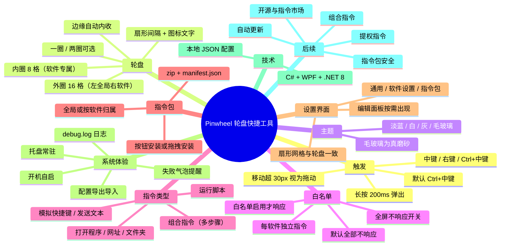

# Pinwheel 设计文档

> 状态：实现现状版 · 最后更新 2026-10-18

## 1. 项目概述

Pinwheel 是一款 Windows 11 桌面效率工具，定位类似 Quicker。按住鼠标触发键（默认 Ctrl+中键），会在鼠标位置弹出一个圆形轮盘，轮盘上摆放着预先设置好的指令；把鼠标划到某个扇形上松手，就执行对应操作。目标是把「重复、要好几步」的操作压缩成「按住 + 一划」一步完成。

当前阶段：自用；后续计划开源到 GitHub。

## 2. 设计原则

- 简洁、淡蓝为主，界面只在使用时出现，平时常驻托盘、轻量省资源。
- 指令可插件化扩展，新增 / 卸载指令不需要更新核心程序。
- 高频操作优先，所有交互追求最少步数。

## 3. 当前已实现的功能

### 3.1 触发方式

- 支持三种触发键：中键、右键、Ctrl+中键，默认 Ctrl+中键（最不干扰系统）。
- 长按一段时间后才弹出轮盘，默认 200 毫秒，可在设置里改成 100 / 150 / 200 / 300 / 400 / 500。
- 按下后如果鼠标移动超过阈值（默认 30 像素），视为拖动、不弹轮盘，避免和拖动操作冲突。
- 松手时如果停在某个扇形上，执行该指令；停在空白处则不做任何事，并模拟一次原来的点击。

### 3.2 轮盘界面

- 两圈结构：
  - 内圈 8 个扇形：当前软件专属指令。
  - 外圈 16 个扇形：左半 8 个是全局指令，右半 8 个是当前软件专属指令。
- 每个软件可以单独选择「一圈 / 两圈」：一圈只显示内圈 8 格，两圈显示完整的内 8 + 外 16。
- 扇形带间隔，图标在上、文字在下，文字大小按名称长度自动调整。
- 鼠标划到哪个扇形，该扇形放大并高亮。
- 轮盘跟随鼠标弹出；靠近屏幕边缘时自动往屏幕内侧收，保证完整可见。
- 轮盘大小三档：小 / 中 / 大。

### 3.3 主题

四种主题，默认淡蓝：

- 淡蓝：白底扇形 + 淡蓝高亮描边。
- 白：纯白 + 浅灰蓝描边。
- 灰：浅灰扇形。
- 毛玻璃：截取轮盘底下的屏幕画面做高斯模糊当背景，扇形用半透明白叠加，整体是偏白灰蓝的磨砂质感。

### 3.4 白名单与场景

- 所有软件默认不响应触发键；只有加入白名单且「启用」的软件才响应。
- 白名单之外的软件，触发键保持系统默认行为，不拦截。
- 每个白名单软件单独设置自己的一套指令，互不影响。
- 全局指令固定 8 个，在任何软件里都能看到（外圈左半）。
- 每个软件可单独设置「全屏时不响应」，默认开启。

### 3.5 指令类型

当前支持七种指令：

1. 打开程序
2. 打开网址
3. 打开文件夹
4. 模拟快捷键（如 `^c`、`{F5}`）
5. 发送文本
6. 运行脚本（PowerShell，优先推荐，可靠且不干扰键盘）
7. 组合指令（按顺序执行多个步骤，步骤间可设延时，每个步骤都支持上面六种指令）

### 3.6 指令包（插件化）

- 每个指令包是一个 `.zip` 文件，内含 `manifest.json`（名称、图标、类型、目标、归属软件、说明等）和可选的脚本文件（如 `.ps1`）。
- 安装方式：设置界面点「安装指令包…」选择文件，或直接把 `.zip` 拖进设置窗口。
- 卸载：在指令包列表里选中并卸载，自动移除，不需要更新核心程序。
- 归属：指令包可以标记为「全局」（任何软件可用），也可以标记为属于某个进程（如 `EXCEL.EXE`），只在对应软件场景下出现在可选列表里。
- 软件内部自动管理指令目录，用户不需要手动找目录。

### 3.7 设置界面

三个页签：

- 通用设置：触发方式、长按时间、移动判定、轮盘大小、主题、开机自启、错误提醒。
- 软件设置：左侧列表第一项是固定的「全局设置」，下面依次是各个白名单软件；选中后右侧显示对应的指令网格，点哪个扇形就编辑哪个。每个软件还能单独设置触发方式、是否启用、全屏是否响应。
- 指令包：安装 / 卸载指令包，查看指令包说明。

设置里的指令网格和实际轮盘一致，都是八分之一扇形加间隔，不是方块。编辑面板默认收起，点中某个扇形后才在底部出现，给轮盘留出更多空间。
编辑面板里提供「测试」按钮，可以直接运行当前编辑的指令，方便调试脚本或确认网址、程序路径是否有效。

### 3.8 托盘与自启

- 常驻系统托盘，可随时退出。
- 支持开机自启（写入当前用户注册表启动项）。

### 3.9 错误提示

- 指令执行失败时，在托盘右下角弹气泡提醒（可在设置里关闭）。
- 执行日志写在 `debug.log`，便于排查。

### 3.10 配置备份

- 设置里提供「导出配置」：把当前全部设置保存成一个 `.json` 文件。
- 「导入配置」：选择之前导出的文件，确认后覆盖当前设置并立即生效。
- 适合换电脑、重装系统，或把一套配置分发给别人。

## 4. 技术选型

- 语言与框架：C# + WPF，.NET 8。
- 理由：Windows 原生、常驻内存小、透明置顶圆盘和全局鼠标钩子成熟、发布文件小。
- 依赖全局 .NET 8 运行时，不做自包含发布，保持文件小。

## 5. 数据存储

- 本地 JSON 文件：`config.json`（位于程序目录，随程序分发目录存放）。
- 内容：触发设置、轮盘大小、主题、全局指令、各软件的指令与开关、指令目录等。

## 6. 构建与发布

- 源码目录：`src/Pinwheel/Pinwheel.csproj`。
- 发布命令：

  ```powershell
  dotnet publish src/Pinwheel/Pinwheel.csproj -c Release -o publish/release
  ```

- 运行程序：`publish/release/Pinwheel.exe`。
- 发布前如果程序正在运行，需要先退出，否则发布文件会被占用。

## 7. 目录结构（简）

- `src/Pinwheel`：程序源码。
- `publish/release`：发布产物。
- `docs/design.md`：本文档。
- `指令包/*.zip`：内置示例指令包。

## 8. 今日改动记录（2026-10-18 收尾）

- 毛玻璃主题改为「截屏 + 高斯模糊」的真磨砂效果，色调调成偏白灰蓝、更淡。
- 全局功能合并进「分软件」页：左侧第一项是固定的全局设置，不再单独一个页面。
- 编辑面板改为点中扇形后才出现，整体更紧凑，轮盘区域变大。
- 修复全局指令格子的图标和文字底部被截断的问题。
- 修复设置扇形只能点空白区域的问题，现在图标和文字区域整块都可点。
- 修复分软件两圈布局显示不全的问题。
- 设置界面整体重做：淡蓝灰背景、白色圆角卡片、药丸形页签、统一主色、加大间距；长软件名用省略号显示。

## 9. 后续规划（尚未实现）

- 指令执行失败时轮盘中心闪红（当前只有托盘气泡）。
- 组合指令、多步骤编排、条件判断。
- 管理员权限指令（个别指令提权）。
- 指令包来源提示与安全校验。
- 自动更新检查。
- 多语言界面。
- 开源准备：项目名、README、GitHub 仓库、指令市场。
- 如需更完整的成品 UI，可评估引入 `lepoco/wpfui` 或 `iNKORE-NET/UI.WPF.Modern`（会增大依赖与体积）。

## 10. 思维导图


